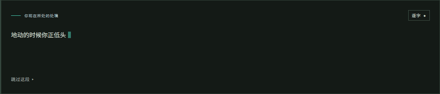
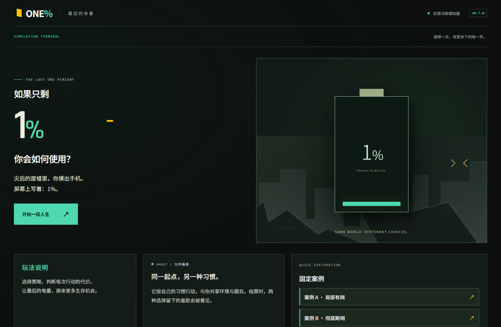
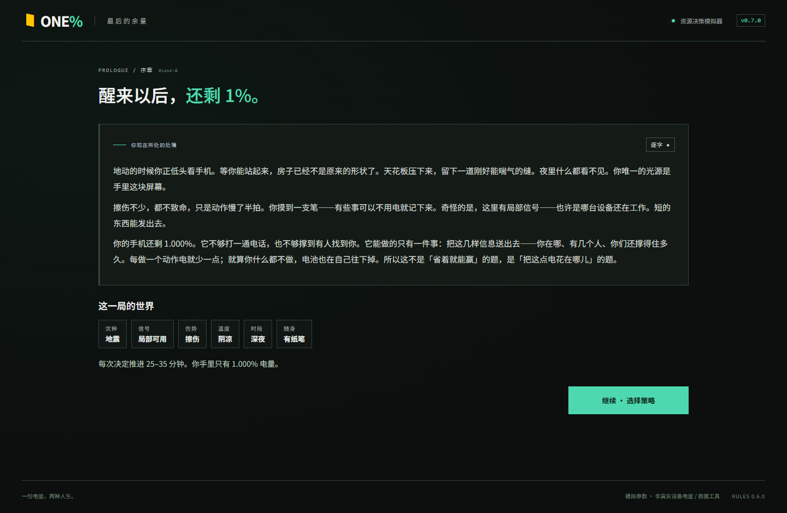
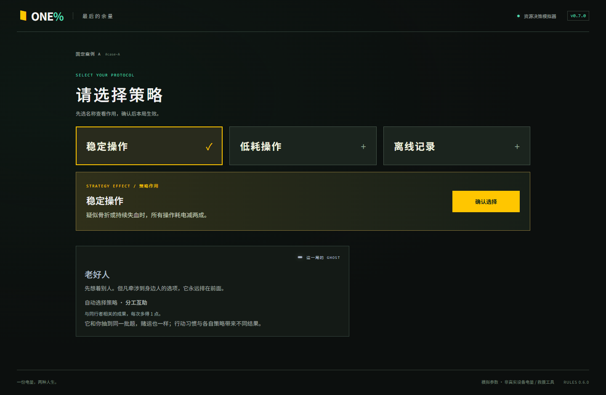
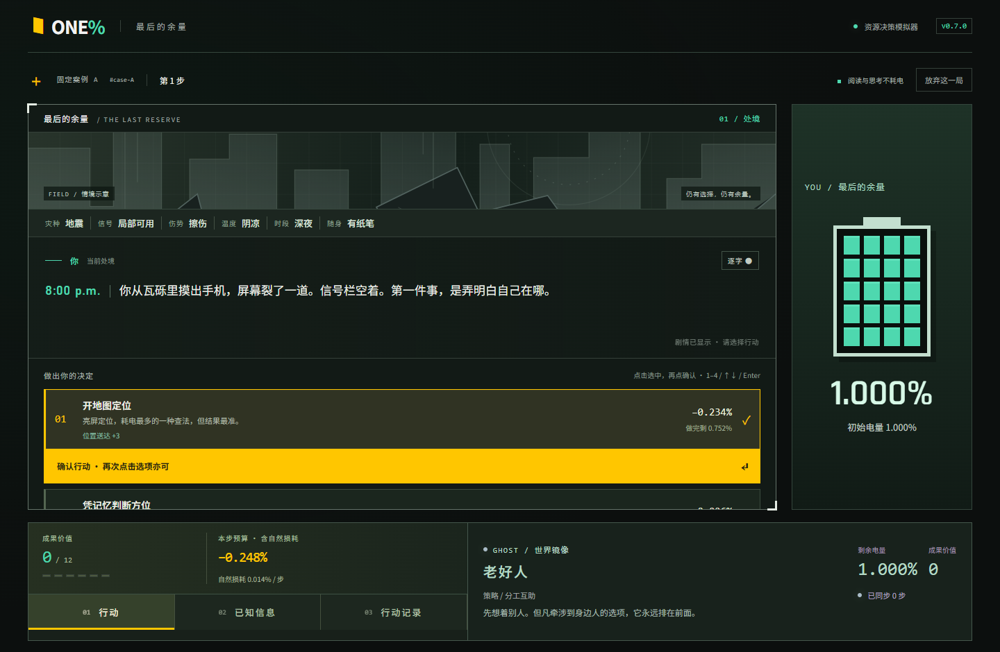
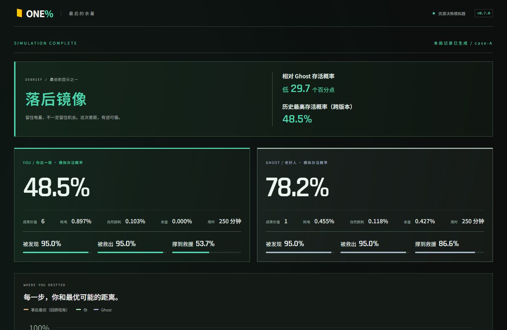
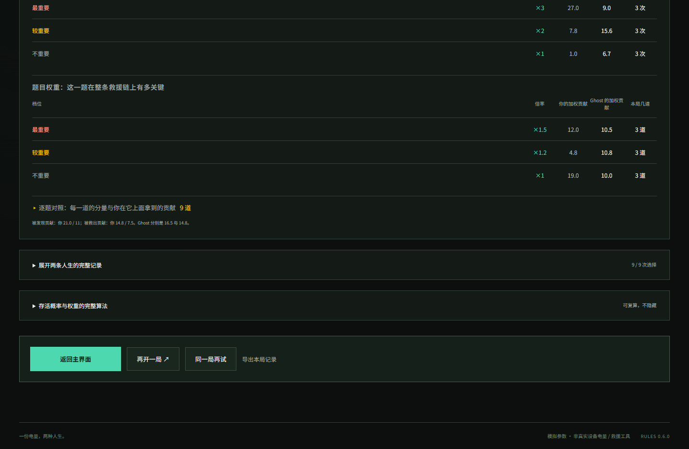

# 1% Battery · 最后的余量

> 一场地震之后，你从瓦砾里摸出手机，屏幕裂了一道，信号栏空着。
> 屏幕上写着：**1%**。
> 往后每一步都在花这一点电——花在哪，决定你能不能活到被找到。



**在线试玩：<https://one-percent-battery-v07.app.workbuddy.host/>**
（v1.0.0 只补文档与素材，游戏内容与 v0.7.0 完全一致，因此沿用这条已验通的链接。历史版本链接见 [`app/README.md`](app/README.md)。）

---

## 目录

- [一、这是什么](#一这是什么)
- [二、一局怎么走（操作说明）](#二一局怎么走操作说明)
- [三、规则与数值](#三规则与数值)
- [四、与赛题的关系](#四与赛题的关系)
- [五、用数据说明表现](#五用数据说明表现)
- [六、技术实现](#六技术实现)
- [七、版本沿革](#七版本沿革)
- [八、数据、素材与许可](#八数据素材与许可)

---

## 一、这是什么

一个**灾后资源决策模拟器**。你手上只有 1.000% 的电量，要在 8~12 步之内决定这点电花在哪：
是打开地图把位置定准，还是省下来等一个更好发送时机；是把信息一次发全，还是先发一半、
留一半电量给后面的意外。

它和「刷分游戏」的区别在于结算输出的东西：不是一个分数，而是一个**存活概率**——
`被发现 × 被救出 × 撑到救援`，三段各自有明确的来源，可以逐项复算。跟你对照的 Ghost
不是一个 AI 对手，而是**同一世界里、同一个时间轴上、按另一套日常习惯行动的你**。

你不用打败它，你只需要看清自己这一局把电花得值不值。



---

## 二、一局怎么走（操作说明）

**1. 进入 → 看清处境。** 点「进入模拟器」后先看这一局的背景：灾害类型、信号状态、
伤势、温度、时段、身上有什么。这些不是装饰——它们直接决定后面每个选项的实际耗电和收益。
正文逐字敲出来，想快点看完就点一下正文或按 Enter。



**2. 选一个策略。** 三种策略先选名字再看效果，选中的会展开说明；
再点一次同一个可以收起，确认后才生效。



**3. 在每一步做选择。** 左侧是当前处境和四个选项，右侧只有你的电量：一个 20 格的像素电池
加精确到小数点的百分比。每个选项都标着**这一步会花多少电**和**做完还剩多少**。


点选项只是选中，卡片会变黄并提示「确认行动」——避免手滑把电花掉。



键盘也能全程操作：数字键 1–4 选择、方向键切换、Enter 确认、Escape 取消。
正文还没打完时，第一次按 Enter 只是补全文字，再按一次才真正执行。

**4. 看结算。** 页面会停在最上面（不会让你滚半天找不到结果），先给你三个数：
你的存活概率、Ghost 的存活概率、以及你相对它的差距。



往下是**逐步曲线**（你 / Ghost / 事后最优参考线）、**两层权重表**、**逐题对照**，
最后是完整公式。哪一步走偏了，一眼能看出来。



**5. 重开。** 可以「再开一局」换一个世界，也可以「同一局再试」用同一个种子重打一次，
看看换个打法会怎样。中途不想玩了，右上角「放弃这一局」可以直接重开，不留半成品记录。

---

## 三、规则与数值

### 唯一硬约束：1.000%

内部以 `1000` 为单位记账，`1` 单位 = `0.001%`。所有选项的标价都是**名义成本**，
实际扣多少要看当下环境：

```
行动耗电 = 名义成本 × 环境倍率 × 1.3，再应用策略折扣
自然损耗 = round(14 × 温度系数 × 信号系数 × 本步分钟 ÷ 30)
```

所以「开地图定位」在信号满格的阴凉处和在断网的烈日下，不是同一件事。
电量耗尽后不耗电的动作仍然可以做，但手机会关机——那本身是一项很重的惩罚。

### 时间是第二重压力

每一步推进 **25 / 30 / 35 分钟**（由这一局的种子决定，双方共用同一张时间表），
剧情顶部显示钟表和跨日。这 25~35 分钟里电池**自己也在掉**——什么都不做，电照样少。
这是「舍不得花」的代价：你能撑到救援的概率，跟累计过去了多少分钟直接挂钩。

### 权重有两层，但过程里一个都不显示

```
每步贡献 = 该成果的实际点数 × 动作档位倍率 × 题目权重倍率
```

| 层 | 三档倍率 | 谁决定 |
| --- | --- | --- |
| 动作档位 | 最重要 ×3 / 较重要 ×2 / 不重要 ×1 | 题库写死或按成本推导 |
| 题目权重 | ×1.5 / ×1.2 / ×1.0 | 每局由种子抽定，约三成是关键题 |

**两层在过程中一律不显示**，结算时才摊开。这一条是刻意的：如果选项上直接标着
「最重要」，那玩家做的就不是判断，而是算术。同一道题这局可能是关键、下局只是铺垫，
你得靠自己判断这一步值不值得花电。

顺带一个归因上的取舍：题目倍率（1.5/1.2/1.0）**故意比动作倍率（3/2/1）温和**。
按 3/2/1 的话，玩家输的时候有一半责任可以推给「抽到关键题还是铺垫题」；
压温和之后，输赢主要归因于自己的选择，而不是手气。

### 结算：存活概率

```
模拟存活概率 = P(被发现) × P(被救出) × P(撑到救援)

P(被发现) = 0.21 + 0.87 ×（被发现贡献 ÷ 11），上限 0.95
P(被救出) = 0.24 + 0.85 ×（被救出贡献 ÷ 7.5），上限 0.95
P(撑到救援) = 0.78 + 0.42 × 剩余电量比例
              − 0.009 ×（累计分钟 ÷ 30）− 伤势惩罚 − 温度惩罚 − 关机惩罚（0.15），下限 0.03
```

六类成果按门槛累积（位置 4 / 人数 2 / 光信号 3 / 传达 2 / 回联 4 / 接力 3），
对应价值 3/1/2/1/3/2。结算页把三档动作、三档题目、每一道题的实际贡献全部列出来，
配完整公式，可以自己复算。事后最优参考线由有限宽度搜索算出——它是**理论上限**，
不是标准答案，也不能声称是穷举得到的全局最优。

---

## 四、与赛题的关系

赛题对 1% Battery 方向的要求（原文核对日期 2026-10-12）：

> 选择 1% Battery 的团队需说明所选的资源约束，并通过对比数据或演示展示作品的表现。
> 每支队伍需在提交材料中列出一到两个与作品最相近的已有产品或项目，并陈述作品相比它们的先进性与不同之处。
> **与已有作品相似本身不扣分，说不清差异才会影响评分。**

### 逐项对应

| 赛题要求 | 本项目的回答 | 在哪儿能看到 |
| --- | --- | --- |
| 说明所选的资源约束 | 设备电量 1.000%（1000 单位），叠加上每步 25/30/35 分钟的游戏时间；耗电只来自主动操作与环境导致的自然损耗 | 主页、局内右侧电量栏、结算公式 |
| 通过对比数据展示表现 | 三种典型打法 × 60 个种子的模拟统计，以及玩家与 Ghost 的逐项对照 | [第五节](#五用数据说明表现)、结算页 |
| 列出最相近的已有作品 | 《人生重开模拟器》、手机厂商的「1% 应急模式」 | 本节下方 |
| 陈述先进性与差异 | 三条差异主张，每条都能当场验证 | 本节下方 |
| 作品可交互、可演示核心功能 | 浏览器里能完整玩完一局，含两个固定案例（A 局部有网 / B 彻底断网） | 在线试玩链接 |
| 说明哪些部分是模拟 | 全部能耗、概率与人物都是模拟参数，不是设备实测 | 页脚、结算页、导出 JSON |
| 说明设计决策与技术取舍 | 设计文档、实施计划与版本沿革 | `drafts/`、[第七节](#七版本沿革) |

### 最相近的两个作品

| 维度 | 最相近的已有作品 | 根本差别 |
| --- | --- | --- |
| 玩法形态 | 《人生重开模拟器》（[VickScarlet/lifeRestart](https://github.com/VickScarlet/lifeRestart)，MIT） | 它用**属性数值**决定人生走向；我们用**可计量的资源成本**驱动，全程可复算 |
| 主题场景 | 厂商的「1% 应急模式」（华为 Mate50 / 小米 13 Ultra / OPPO Find X7 Ultra） | 它是**系统替你关掉功能**；我们是**让你自己决定这点电花在哪**，并给出可比较的证据 |

表现形式确实借鉴了人生重开模拟器（文字事件 + 选项 + 局末总结 + 可重开），
这一点我们直说，不回避。我们的工作量不在发明这个形式，而在下面这三条。

### 三条差异主张（都能在作品里当场验证）

**1. 成本是算出来的，不是写死的。** 同一个动作在不同环境下的实际耗电不同，
差异来自温度系数、信号系数和那 1.3 的整体倍率——不是设计者编的剧情，是规则推导的结果。

**2. 对照是同环境实时的，而且 Ghost 不是最优解。** Ghost 与玩家共享同一个世界
（同一批题、同一张时间表、同一次赌运），按自己的习惯行动，不预知未来、不读取你的选择。
它可能因为行动及时抢到你错过的成果，也可能因为反复启动白白耗光电量。**玩家可以输给它**，
系统不保证玩家赢。

**3. 每一份消耗都能追溯到「换来了什么」。** 结算页的逐题对照列出：那一刻的处境、
你的选择、实际成本、拿到的成果，以及它改变了后面的哪些机会。导出的 JSON 可以由
`verifyExport` 重算回来。

### 哪些是模拟

> **本项目不修改任何设备设置，不产生任何真实省电效果。**
> 游戏中的电量、信号、伤势、人物与所有概率都是**模拟参数**，不是设备实测或真实救援预测。
> 报告里引用的厂商应急模式数据均来自厂商实验室公布，不得写成我们的实测。

赛题 FAQ 明确说明不必测量真实电量、允许以模拟形式呈现，我们据此选择模拟路线，
并把「哪些是模拟」在界面页脚、结算页和导出 JSON 里反复标注。

---

## 五、用数据说明表现

同一套规则引擎、60 个随机种子、四种典型打法各跑一局，无人工挑选：

| 打法 | 存活概率均值 | 区间 | 结束时剩余电量 | 成果价值 | 中途只能空转 |
| --- | ---: | --- | ---: | ---: | ---: |
| 激进（每步挑收益最高） | 41.3% | 14.7% ~ 66.8% | 17 / 1000 | 4.2 | 46 / 60 |
| 保守（每步挑最便宜） | **58.8%** | 14.7% ~ 85.7% | 463 / 1000 | 3.1 | 1 / 60 |
| 性价比（单位电量收益最高） | 58.7% | 11.2% ~ 85.7% | 385 / 1000 | 3.7 | 2 / 60 |
| 什么都不做 | 4.7% | 4.0% ~ 4.8% | 774 / 1000 | 0.0 | 0 / 60 |
| **事后最优参考线** | **73.5%** | 60.5% ~ 85.7% | — | — | — |

这张表想说三件事：

1. **省电本身不是目标。**「什么都不做」能留住 77% 的电，存活概率只有 4.7%——
   电没花出去，成果就是零。资源效率必须和成果一起看。
2. **激进不是更优解。** 激进派把成果拉到 4.2（全场最高），却把电烧到只剩 17/1000，
   46 局中途就空转了；存活概率反而低于保守派近 18 个百分点。
3. **好打法离理论上限还有距离。** 事后最优 73.5%，而真人打法约 41%~59%，
   中间那段差距就是这个游戏可玩的地方——它不是靠记答案能填平的。

题数在 8~12 上分布均匀（60 局：8 题 15 局 / 9 题 12 局 / 10 题 11 局 / 11 题 11 局 / 12 题 11 局），
玩家事先不知道这一局会走几步。

> 以上均为规则模型内的统计，用于说明规则行为，**不代表任何真实设备的测量结果**。

---

## 六、技术实现

React 19 + TypeScript + Vite，纯前端，无后端、无账号、无外部服务调用。
应用完全在浏览器里跑，存档存在本地。

```
app/
  src/game/         规则层（纯函数，与界面无关，可单独测试）
    config.ts         所有数值常量：电量单位、时间、权重倍率、存活模型
    world.ts          按种子生成一局世界：环境、题组、策略候选、Ghost 性格、题数
    engine.ts         实际耗电、自然损耗、成果结算、可选项判定
    timeline.ts       确定性时长、累计分钟、钟表显示
    scoring.ts        加权贡献与三段存活概率
    oracle.ts         事后最优参考线（有限宽度搜索）
    ghost.ts          镜像行为
    replay.ts         一局的流程推进与回放
    rng.ts            确定性随机（FNV-1a + xorshift）
    content/          130 道题库（早 32 / 中 40 / 晚 32 + 固定案例）、12 种策略、6 种 Ghost 性格
  src/components/   界面层
  src/protocol.css  v0.7 视觉层
  tests/            浏览器验收（Playwright）
```

**确定性。** 一个种子决定这一局的全部：环境、题目、隐藏的题目权重、策略候选、
Ghost 习惯、每步时长和赌运。同一局编号必然复现同一组；玩家与 Ghost 在同一个选项上
抽到同一个赌运结果，所以差距只来自选择。固定案例 A / B 连种子一起固定，
演示和回归测试才对得上。

**验证。**

```sh
cd app
npm ci
npm test              # 规则、时间轴、题库、平衡性：81 项
npm run test:browser  # 浏览器实际流程：27 项（含自动刷新 README 截图）
npm run build         # 生产构建
```

浏览器验收跑在真实 Edge 里，覆盖完整一局、键盘操作、打字机行为、中途放弃、
结算滚动位置、窄屏不溢出等。`tests/shots.spec.ts` 会在跑测试时顺手把
`assets/screens/` 下的界面截图重新生成一遍——界面改了，README 里的图就跟着变，
不用手工替换。

---

## 七、版本沿革

每一版一条独立分支，`main` 至今锁在 v0.1.0 基线未动。

| 版本 | 关键变化 |
| --- | --- |
| v0.1.0 | 可玩首版：160 秒时间轴、10 个电量单位、Ghost 对照与可复算复盘 |
| v0.2.0 | 取消时间轴，改抽题制；题库扩到 130 道；电量改 0.001% 记账；加入策略三选一、环境轴与随机 Ghost 性格 |
| v0.3.0 | 时间以「每步固定 15 分钟」回归，并引入自然损耗；电量随环境变动；**结算从打分改为算存活概率** |
| v0.4.0 | 权重拆成「动作 + 题目」两层并全部藏到结算之后；重标定概率模型，把事后最优拉回 70% 左右 |
| v0.5.0 | 界面改造为灾难终端风格；剧情与选项居中，底部资源与操作栏 |
| v0.6.0 | 天赋改称策略（先选名字再看效果）；局内每步四选项、卡内二次确认；时间改为按种子取 25/30/35 分钟 |
| v0.7.0 | 引导流程独立成页；右侧像素电池 + 精确电量；Ghost 移至屏幕底栏；内置本地开源字体 |
| **v1.0.0** | **交付定稿：补全本文档与界面素材。游戏规则与 v0.7.0 完全一致，未改动玩法** |

规则版本号独立于界面版本号，v1.0.0 对应规则版本 0.6.0（v0.6.0 之后只改界面，没动规则）。

设计与实施过程文档见 `drafts/`，各版交付说明见 `content/`。

---

## 八、数据、素材与许可

- **存档**只保存在浏览器本地，不上传任何个人信息；存档带 schema 版本，不兼容的旧记录
  会被保留为可下载的备份，而不是悄悄丢掉。
- **导出**的 JSON 含规则版本、种子、每次选择与结果，可由 `verifyExport` 重算。
- **界面图形**全部由 CSS 与内联 SVG 绘制；字体为本地内置的开源授权字体
  （Rajdhani、Noto Sans SC 子集），来源与许可见 `app/public/fonts/`。
- **依赖**：React、Vite、TypeScript、Vitest、Playwright，
  版本与来源见 `app/package.json` 及 `package-lock.json`。
- **视觉参考**：[Stronghold-Protocol](https://github.com/sganggs/Stronghold-Protocol)
  （参考配色与层次，未复制任何素材）。
- 灵感来自用户指定的人生重开模拟器形式；本项目在其之上加入统一成本模型、
  同环境 Ghost 对照与因果复盘。相近作品正式引用与比赛提交说明以
  `content/1012_相近作品调研与差异说明_v1.md` 为准。
