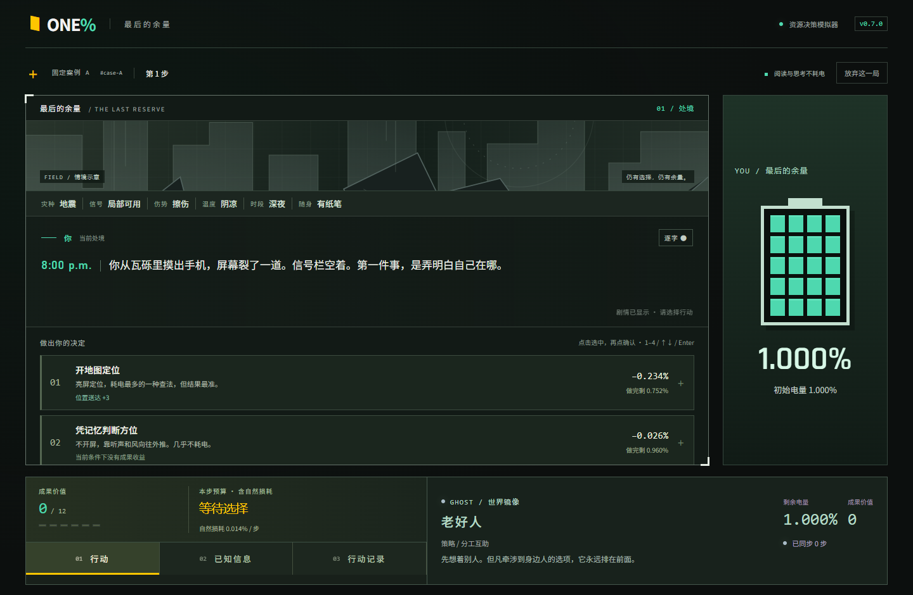

# 1% Battery · v1.0.0

灾后资源决策模拟器：在最后 **1.000%** 电量内做出选择，与采用日常行为习惯的 Ghost 对照资源消耗和模拟结果。Ghost 不是最优解，也不保证玩家获胜。

- 项目全貌——为什么这样做、与赛题和相近作品的关系、带图的操作演示：见[仓库根 README](../README.md)。
- 界面素材在 `../assets/screens/`，由 `tests/shots.spec.ts` 在跑浏览器测试时自动重新生成。



## 本版变化

**v1.0.0（本版）**：补全交付文档与界面素材，并修掉一条在慢机器上会超时的平衡性测试。
**游戏规则与界面和 v0.7.0 完全一致，未改动任何玩法数值。**

v0.7.0 的界面改动：

- 流程为初始剧情 → 独立策略页 → 对局；再次点击同一策略会收起说明，确认后生效。
- 剧情和四选项在左，右侧仅玩家电量：20格像素电池表示最后1%的剩余预算，另保留精确百分比。
- Ghost 移至屏幕底部，保持前一步结果的对照方式；上一步行动回声在剧情区可展开。
- 主页保留主要入口、简短玩法、独立 Ghost 介绍与固定案例。
- 结算将相对 Ghost 差值和跨版本历史最高分成两行；分段概率的数值靠近标签。
- 规则与题库保持 v0.6.0，现有存档继续兼容；本版仅升级界面版本。

视觉参考 [Stronghold-Protocol](https://github.com/sganggs/Stronghold-Protocol)。未复制游戏素材；本地附带 OFL 许可 Rajdhani 数字字体与 Noto Sans SC 字符子集，许可与来源见 public/fonts/README.md。

## 启动与验证

需 Node.js 24 或更新的兼容版本，已验证 Windows + Edge。

```powershell
cd app
npm ci
npm run dev
npm test
npm run test:browser
npm run build
```

浏览器打开 Vite 输出的地址。应用完全在浏览器内运行；依赖首次安装需要网络。浏览器测试默认使用Edge；若改用Chromium，先安装Playwright Chromium并设置`PLAYWRIGHT_CHANNEL=chromium`。

当前 v1.0.0 的验证结果：单元与规则测试 **81 项通过**，浏览器验收 **27 项通过**
（其中 `tests/shots.spec.ts` 会在测试过程中刷新 `assets/screens/` 的界面截图），
`tsc -b` 与生产构建通过。规则层测试跑 `npm test` 即可，其中事后最优参考线那一条
需要 40 个种子 × beam 搜索，已单独放宽超时（慢机器上约 7 秒），不要靠调小种子数让它"变快"。

本版预览与交付状态见 [交付说明](../content/1013_v10交付说明_v1.md)。历史独立地址保持不动：
- v0.7：https://one-percent-battery-v07.app.workbuddy.host/ （v1.0.0 沿用它，内容一致）
- v0.4：https://one-percent-battery-v4.app.workbuddy.host/
- v0.3：https://one-percent-battery-v3.app.workbuddy.host/
- v0.2：https://one-percent-battery.app.workbuddy.host/

## 操作和规则

一局8–12步，界面不提前显示总步数。数字键1–4选择、方向键切换、Enter确认、Escape取消选择；逐字尚未完成时，Enter或确认按钮只补全文字，再次操作才执行。系统减少动效和手动立即显示均受支持。

种子确定世界环境、题目、隐藏题目权重、策略候选、Ghost习惯、赌运和每步时长。固定案例A为9步、B为11步。同版本同种子可重放。Ghost局内显示前一步结果，避免泄露下一步；结算补全。双方共享时间表和赌运，内部状态独立。

环境参数按开局场景确定，本版没有随钟表时间自动切换天色。白天从12:00 p.m.、黄昏从6:00 p.m.、深夜从8:00 p.m.开始。

### 能耗与时间

内部1000单位等于屏幕1.000%，每单位0.001%。

```
行动耗电 = 名义成本 × 环境倍率 × 1.3，再应用策略折扣/抵扣
自然损耗 = round(14 × 温度系数 × 信号系数 × 本步分钟 / 30)
累计时间 = 各步时长之和
```

自然损耗扣到零为止，预览与实际扣除一致。为保留旧版本典型一局的资源压力，14单位基准由旧15分钟整步归一到30分钟；所有参数都是模拟值。间歇待机抵扣行动成本，最低为0，不给电池充电。

电量耗尽后免费行动仍可进行；关机处罚保留。六类成果按门槛累计：位置4、人数2、光信号3、传达2、回联4、接力3，对应成果价值3/1/2/1/3/2。

### 结算

```
模拟存活概率 = 被发现 × 被救出 × 撑到救援
成果贡献 = 实际点数 × 动作档位倍率 × 题目权重倍率
撑到救援的时间处罚 = 0.009 × 累计分钟 / 30
```

动作倍率3/2/1，题目倍率1.5/1.2/1，两层只在结算揭晓。完整归一化参数、伤势、温度与关机处罚见`src/game/config.ts`，结算提供逐题对照和公式。事后参考线由有限宽度搜索计算，区别于Ghost，不能声称为穷举得到的全局最优。

## 数据与结构

规则版本0.6.0。旧规则的对局不直接载入，原始记录保留为可导出的备份；导出JSON含规则版本、种子、选择与日志，可由`verifyExport`重算。

- `src/game/timeline.ts`：确定性时长、累计分钟、钟表展示。
- `config.ts`、`engine.ts`、`scoring.ts`：资源规则和可解释结算。
- `content/questions.ts`、`content/bank/`、`content/fourthOptions.ts`：130题×4项。
- `content/talents.ts`：12种策略，保留内部ID。
- `src/components/`：入口、主页、策略、剧情行动、Ghost、结算。
- `src/protocol.css`：v0.7视觉层；`tests/`为浏览器验收。

所有耗电和概率均为模拟，不是设备实测或真实救援预测。3–5分钟为体验目标。main保持旧基线，各版本单独分支，v0.7从v0.6提交e642a1e开始。

### v0.6 审查补充

环境明确阻止新增行动生效时，`EnvRule.blocksGain`禁止策略加成恢复成果；行动成本仍支付。旧版环境修正保持原有口径。历史最佳值保留，并标明跨版本，不能作为同规则进步幅度。审查修复与测试证据见交付说明。
