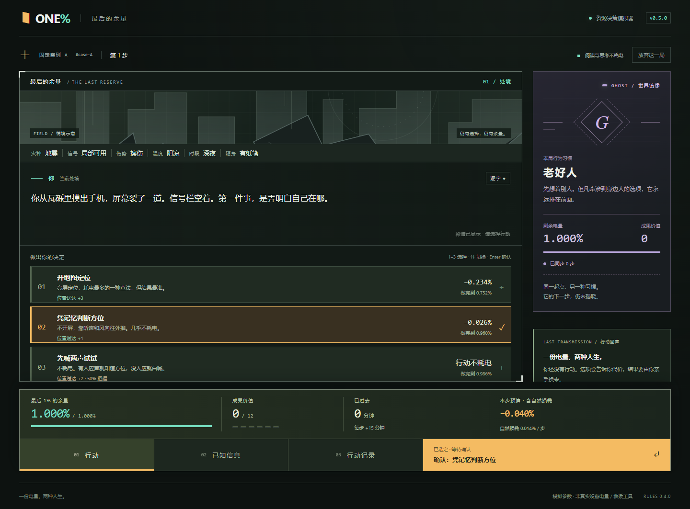

# 1% Battery v0.5.0 · UI 交付

2026-10-13。基于远端 `v0.4.0` 的 `682f81f`，新分支 `v0.5.0`。没有修改游戏引擎、题库、概率参数、存档 schema 或旧版部署。

## 试玩

- 本机：[http://localhost:5175/](http://localhost:5175/)，当前开发预览；本机服务关闭后需在 app 中运行 `npm run dev -- --port 5175`。
- 独立 Sites 私有预览：[https://one-percent-battery-v05.maplesmile512.chatgpt.site](https://one-percent-battery-v05.maplesmile512.chatgpt.site)。平台已返回 succeeded，需使用站点所有者的 ChatGPT 账号访问。未登录 HTTP 请求返回401，所以不能把它当作免登录的评委公开演示链接。
- 原 [v0.4.0](https://one-percent-battery-v4.app.workbuddy.host/) 保持不动；该旧链接未在本轮重新验证。

## 本轮实现

- 原创灾后终端界面：深色背景、细线剧情框、薄荷绿状态、琥珀选中、灰紫 Ghost。场景线稿随灾种变化，仅作氛围示意。
- 中央剧情逐字显示，标点停顿；点击或 Enter 补全。立即显示与系统减少动效均可用，设置单独保存。
- 点击、数字键选择，箭头键切换，明确确认后才推进；双击跳字、按住键、混用鼠标与数字不会误提交。
- 底部显示余量、成果、时间及含自然损耗的本步预算；行动／已知信息／行动记录三个面板。大型桌面独立滚动，小窗口自然滚动；窄屏确认栏紧接选项。
- Ghost 只显示同步后的有限状态。结算仍揭示两层权重、原始记录与事后参考，支持导出与重试。
- 开始页、天赋页、结算页统一风格；修正开始页历史最高概率的百分比格式。没有使用商业游戏美术或复制参考项目代码。

## 验证

- `npm test`：62 passed，包含原有平衡性测试。
- `npm run test:browser`：20 passed。新增安全确认、刷新恢复、立即显示、低高度真实点击、日志余量等回归。
- `npm run build`：通过。JS gzip 122.63 kB，CSS gzip 11.51 kB。
- `git diff origin/v0.4.0 -- app/src/game`：无差异；规则仍为0.4.0，UI与包版本为0.5.0。
- 实际截图：1440×1000、1280×720、390×844；另测试1024×600及1280×600。截图流程浏览器异常0条。
- 独立只读审查发现5处问题，全部先复现失败，再修复并通过全套回归：低高度遮挡、混合输入改回旧选择、双击跳字误提交、已读文字倒退、日志漏算自然损耗。
- 动态验证使用 Windows Edge；未声称测试过 Safari、Firefox、真机或完整读屏器。Sites平台验证发布成功，但未登录HTTP无法验证私有页面资源；本机页面与构建资源另行验证。

## 涉及文件

- `app/src/components/EventScreen.tsx`、`DecisionControls.tsx`：剧情与安全操作。
- `app/src/components/StageScene.tsx`、`app/src/terminal.css`：原创场景与界面样式。
- `app/src/components/useTypewriter.ts`、`TalentScreen.tsx`、`StartScreen.tsx`、`ResultsScreen.tsx`、`app/src/App.tsx`、`main.tsx`：逐字、设置与页面接入。
- `app/tests/game.spec.ts`：20项流程回归。
- `app/package.json`、`package-lock.json`、`README.md`、根 `AGENTS.md`、`drafts/1013_UI实施计划_v05.md`：版本、操作和团队记录。
- `assets/1013_v05*_v1.png`：6张实际截图。项目 `memory/1013_v05实施记录_v1.md` 为本地衔接记录，不上传。

## 实施取舍

- 使用干净的独立版本分支原位开发；账本按项目要求保留，没有复制实现工作树。若另开并行开发，应使用新的worktree。
- 小桌面采用自然滚动，代价是需要向下滚到确认栏，换取完整可读的选项。
- 文字倒退和日志余量问题按重要问题处理，增加两个回归；没有待推迟的审查问题。
- 托管为独立私有Site，未改现有公开链接或开放访问权限。Git Bash与GNU tar的Windows路径问题已通过进程PATH和 `TAR_OPTIONS=--force-local` 解决。
- 本轮没有使用额度重置卡，也未进行付款。

